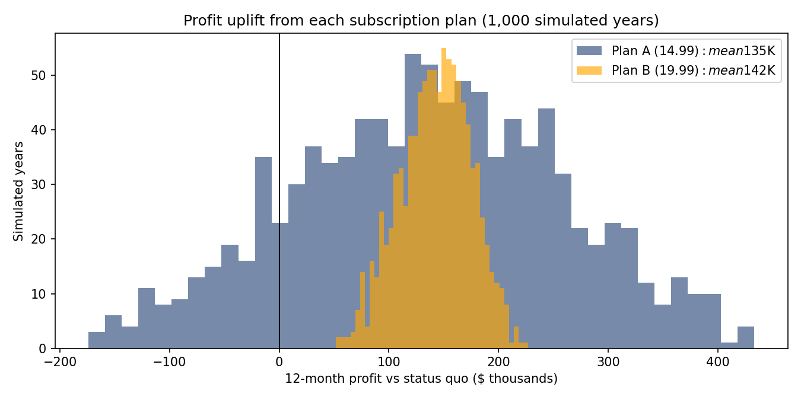

# Subscription Pricing Decision Under Uncertainty (Monte Carlo)

**Question:** Should a 20-store coffee chain launch a monthly subscription, and at which price ($14.99 or $19.99), when sign-ups, churn, redemption, and cannibalization of full-price sales are all uncertain?

**Answer:** **Launch Plan B at $19.99.** It adds about **$142K** of 12-month profit and beats the status quo in **100% of 1,000 simulated years**, with a quarter of Plan A's volatility.



## Results (1,000 simulated years each)

| Option | Mean 12-month profit | 5th percentile | Std dev | Beats status quo |
|---|---|---|---|---|
| Status quo | $2.83M | $2.82M | $6K | — |
| Plan A ($14.99) | $2.96M | $2.76M | $123K | 85% |
| **Plan B ($19.99)** | **$2.97M** | **$2.92M** | **$31K** | **100%** |

## Stress test
| Scenario | Plan A uplift | Plan B uplift |
|---|---|---|
| Base case | ~$130K | ~$141K |
| Churn +10 points | ~$70K | ~$92K |
| Redemption -10 points | ~$425K | ~$220K |

**Takeaways:** churn is the risk to manage (retention offer plus a churn dashboard from launch); lower redemption improves margins, so it is a lever rather than a threat.

## How the model works
- Daily demand per store: truncated normal (mean 210 cups).
- Monthly: uniform churn, triangular sign-ups per store ($3.20 acquisition cost each), subscription revenue.
- Daily: uniform redemption share of subscribers; a triangular share of redemptions cannibalizes full-price sales.
- $40,000 setup cost for either plan; fully vectorized in NumPy (1,000 years x 360 days x 20 stores).

## Tools
Python · NumPy · pandas · matplotlib · Jupyter

```bash
pip install -r requirements.txt
jupyter notebook subscription_pricing_simulation.ipynb
```

---
*Context: rebuilt from a group assignment in Managerial Decisions Modelling (UBC Sauder MBA, 2025). I re-implemented the model in vectorized NumPy with one consistent set of assumptions, and added the risk metrics and stress test.*
